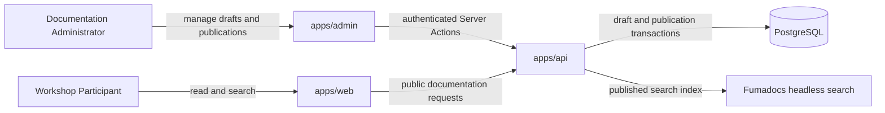
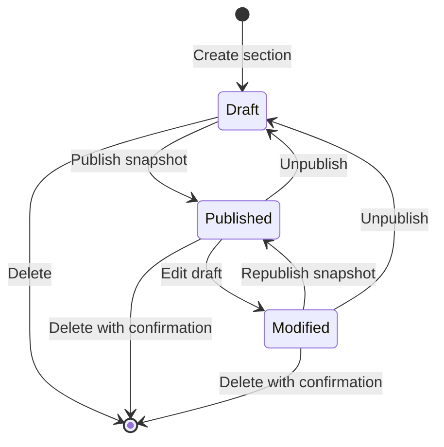
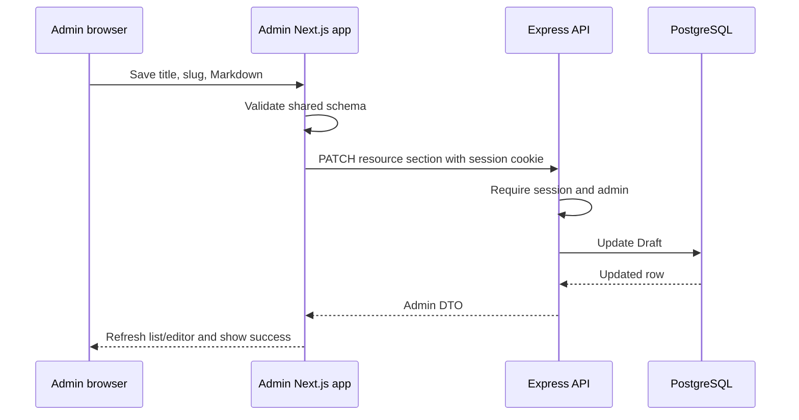
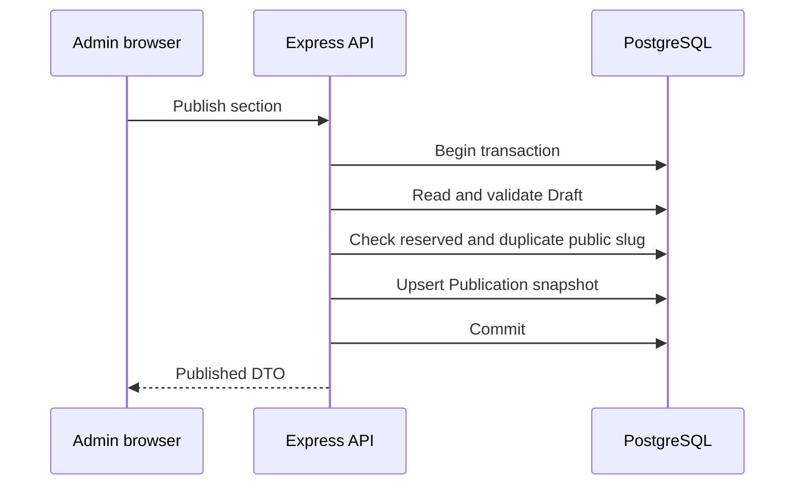
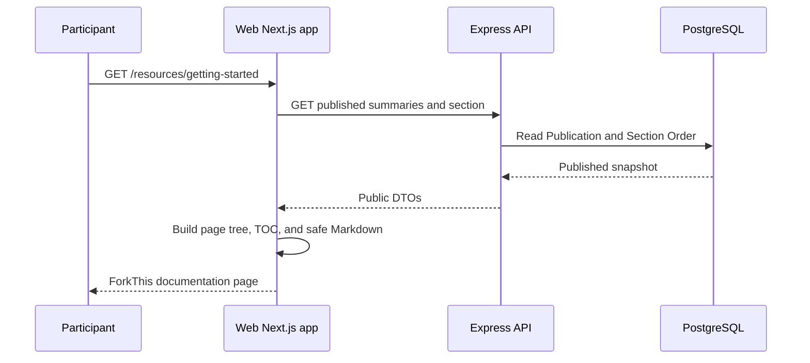

# ForkThis Workshop Documentation Architecture

## 1. Purpose

ForkThis needs a documentation experience for teaching Git and GitHub without turning the Resources area into a separate product. Administrators author lessons as Markdown, review them privately, and publish stable snapshots. Participants read those lessons through documentation-style navigation while retaining immediate access to the existing ForkThis navbar, Dashboard, Leaderboard, authentication controls, and Additional Resources.

This document describes the target architecture. It does not claim that the feature is already implemented.

## 2. Goals

- Present workshop lessons as linkable documentation pages under `/resources`.
- Preserve the existing ForkThis visual identity and global navigation.
- Let administrators paste and edit Markdown without uploading files.
- Keep draft edits private until an explicit publish action.
- Provide ordered page navigation, an H2/H3 page outline, previous/next links, and full-text documentation search.
- Keep the existing video, article, and GitHub cards unchanged under Additional Resources.
- Store content durably in PostgreSQL so container replacement does not lose documentation.
- Render the same safe Markdown in admin preview and on the public website.

## 3. Non-goals

- Executable MDX, JSX, embedded scripts, iframes, or arbitrary HTML.
- Uploading or managing images and other binary assets.
- Nested documentation groups in the first version.
- Documentation localization or versioning.
- Revision history beyond the current Draft and current Publication.
- Searching external Additional Resources.
- Replacing the global ForkThis header with a documentation framework theme.
- Introducing a new documentation-only authentication model.

## 4. Current System Constraints

The repository is a Bun/Turborepo monorepo with three relevant applications:

- `apps/web`: Next.js participant-facing application. Its root layout owns `SiteHeader`, the global navigation, authentication actions, fonts, frame, and TanStack Query provider.
- `apps/admin`: separate Next.js administrative console using shadcn components, Server Actions, and server-side API calls.
- `apps/api`: Express API. Public modules are mounted below `/api`; administrative routes are protected by `requireSession` and `requireAdmin`.

Shared packages currently include PostgreSQL/Drizzle persistence and administrative contracts. The Resources page is currently static and renders three card collections from source-controlled data. There is no documentation content table or documentation API.

These constraints lead to four architectural rules:

1. The Express API remains the authority for documentation content and publishing.
2. PostgreSQL stores editable and published content; the Docker filesystem is not content storage.
3. The participant web application keeps its existing root layout and header.
4. The admin application follows its existing authenticated API and Server Action patterns.

## 5. Technology Choice

### 5.1 Fumadocs Core, not the Fumadocs theme

Use Fumadocs Core/headless utilities for the solved documentation behavior:

- page-tree types and navigation relationships;
- Markdown-derived table of contents;
- active heading observation;
- structured search records;
- headless search client/server behavior.

Do not install or mount the complete Fumadocs documentation layout or its navbar. A full theme would compete with `SiteHeader`, alter spacing and typography, and make Dashboard and Leaderboard feel outside the documentation experience. The ForkThis web application will render its own documentation shell around headless primitives.

### 5.2 Markdown renderer

Use a shared React renderer based on:

- `react-markdown` for React element rendering without `dangerouslySetInnerHTML`;
- `remark-gfm` for tables, task lists, autolinks, footnotes, and strikethrough;
- `rehype-slug` for stable heading anchors;
- `rehype-sanitize` with an explicit allowlist after transformations.

Do not install `rehype-raw`. Raw HTML remains text or is removed rather than becoming DOM nodes. MDX compilation is deliberately excluded because administrator-authored content must never execute JavaScript.

## 6. System Topology



The web and admin applications never write documentation tables directly. All validation, authorization, publication copying, ordering, and deletion rules live behind API endpoints.

## 7. Domain and Persistence Model

### 7.1 `resource_sections`

Stores the administrator's editable Draft.

| Column | Type | Rules |
| --- | --- | --- |
| `id` | UUID | Primary key, generated by PostgreSQL |
| `title` | text | Trimmed, 1–120 characters |
| `slug` | text | Lowercase kebab-case, 1–80 characters |
| `markdown` | text | Required, maximum 65,536 UTF-8 bytes |
| `position` | integer | Non-negative navigation order |
| `created_by` | UUID | Required reference to `users.id` |
| `updated_by` | UUID | Required reference to `users.id` |
| `created_at` | timestamptz | Defaults to current time |
| `updated_at` | timestamptz | Updated on every draft or order mutation |

Draft slugs are validated but do not need to be globally public until publishing. They should still be unique among active Drafts to prevent ambiguous admin state.

### 7.2 `resource_publications`

Stores the current public snapshot.

| Column | Type | Rules |
| --- | --- | --- |
| `section_id` | UUID | Primary key and cascading reference to `resource_sections.id` |
| `title` | text | Snapshot copied from the Draft |
| `slug` | text | Unique public URL slug |
| `markdown` | text | Snapshot copied from the Draft |
| `published_by` | UUID | Required reference to `users.id` |
| `published_at` | timestamptz | Updated on every publish or republish |

Separating the publication snapshot prevents partially edited content from appearing publicly. Publishing is an upsert performed in one transaction. Unpublishing deletes only the publication row and leaves the Draft intact. Deleting a Documentation Section cascades to its Publication.

### 7.3 Ordering

`position` belongs to the Documentation Section because administrators order the conceptual lessons, not individual snapshots. Public navigation joins Publications to their Sections and orders by `position`, then `created_at`, then `id` for deterministic ties.

The reorder operation receives the complete ordered list of section IDs and updates all affected rows in one transaction. It rejects missing, duplicate, or unknown IDs instead of accepting a partial order.

### 7.4 Reserved route

`additional` is a reserved slug because `/resources/additional` belongs to the source-controlled Additional Resources page. Draft creation and update reject this slug before persistence.

## 8. Shared Contracts

Create `packages/resource-contracts` as `@repo/resource-contracts`. It owns the Zod request schemas and transport DTOs shared by API, admin, and web.

Core request shapes:

```ts
interface CreateResourceSectionRequest {
  title: string;
  slug: string;
  markdown: string;
}

interface UpdateResourceSectionRequest {
  title?: string;
  slug?: string;
  markdown?: string;
}

interface ReorderResourceSectionsRequest {
  orderedIds: string[];
}
```

Core response shapes:

```ts
interface ResourceSectionSummaryDto {
  id: string;
  title: string;
  slug: string;
  position: number;
  publicationStatus: "draft" | "published" | "modified";
  updatedAt: string;
  publishedAt: string | null;
}

interface ResourceSectionAdminDto extends ResourceSectionSummaryDto {
  markdown: string;
  publishedTitle: string | null;
  publishedSlug: string | null;
  publishedMarkdown: string | null;
}

interface PublishedResourceSectionDto {
  id: string;
  title: string;
  slug: string;
  markdown: string;
  position: number;
  publishedAt: string;
}
```

`modified` means a Publication exists but at least one Draft field differs from its snapshot. The server calculates this state; clients do not infer it independently.

## 9. API Design

### 9.1 Public routes

Public routes expose Publications only.

| Method | Route | Result |
| --- | --- | --- |
| `GET` | `/api/resources/sections` | Ordered published section summaries and a revision fingerprint |
| `GET` | `/api/resources/sections/:slug` | One published section or `RESOURCE_SECTION_NOT_FOUND` |
| `GET` | `/api/resources/search?q=...` | Search results for published titles, headings, and paragraphs |

The summary response contains enough data to build Documentation Navigation and previous/next links without downloading every Markdown body.

Public endpoints use `Cache-Control: no-store` initially. The content set is small, and immediate publication visibility is safer than cross-deployment cache invalidation. Caching can be introduced later with measured traffic and an explicit invalidation channel.

### 9.2 Administrative routes

All routes remain below the existing `requireSession, requireAdmin` router boundary.

| Method | Route | Result |
| --- | --- | --- |
| `GET` | `/api/admin/resource-sections` | Ordered Drafts with publication status |
| `GET` | `/api/admin/resource-sections/:id` | Full Draft and Publication snapshot |
| `POST` | `/api/admin/resource-sections` | Create a Draft at the end of the order |
| `PATCH` | `/api/admin/resource-sections/:id` | Update title, slug, or Markdown Draft fields |
| `PATCH` | `/api/admin/resource-sections/order` | Atomically replace Section Order |
| `POST` | `/api/admin/resource-sections/:id/publish` | Validate and copy Draft to Publication |
| `POST` | `/api/admin/resource-sections/:id/unpublish` | Remove Publication while retaining Draft |
| `DELETE` | `/api/admin/resource-sections/:id` | Permanently remove Draft and Publication |

Expected explicit errors include:

- `RESOURCE_SECTION_NOT_FOUND`
- `RESOURCE_SECTION_SLUG_EXISTS`
- `RESOURCE_SECTION_SLUG_RESERVED`
- `RESOURCE_SECTION_ORDER_INVALID`
- `RESOURCE_SECTION_NOT_PUBLISHED`
- `RESOURCE_SECTION_MARKDOWN_TOO_LARGE`

Conflicts return HTTP 409, missing records return 404, invalid input returns 400, and authorization failures retain the existing middleware behavior.

## 10. Publishing Lifecycle



Publishing validates the Draft again inside the transaction, checks public slug uniqueness, and then inserts or replaces the Publication. A failed publish leaves the previous Publication untouched.

## 11. Markdown Security Boundary

Administrator status reduces accidental misuse but does not make stored markup trusted. Both admin preview and public rendering use the same shared renderer and policy.

Allowed content includes:

- headings, paragraphs, emphasis, lists, blockquotes, horizontal rules;
- fenced and inline code;
- GFM tables, task lists, autolinks, footnotes, and strikethrough;
- HTTPS images with alt text;
- `https`, `http`, and `mailto` links.

Disallowed content includes:

- raw HTML and MDX;
- scripts, event handlers, inline styles, iframes, forms, and SVG markup;
- `javascript`, `data`, `file`, and other unapproved URL schemes;
- relative image paths because no asset store exists.

External links open in a new tab with `rel="noopener noreferrer"`. External images load lazily. Heading IDs are sanitized after slug generation to avoid DOM clobbering.

## 12. Shared Markdown Package

Create `packages/markdown` as `@repo/markdown` so preview and public rendering cannot drift.

It exports:

- `MarkdownContent`: the sanitized React renderer;
- `getMarkdownTableOfContents`: an adapter around the Fumadocs TOC utility;
- `getMarkdownStructuredData`: an adapter around Fumadocs `structure()` for search;
- strict URL transformation helpers;
- shared Markdown element props and tests.

The package emits semantic HTML and stable data attributes. Each application owns surrounding layout and theme CSS, while the actual element mapping and security configuration remain shared.

## 13. Participant Web Architecture

### 13.1 Routes

```text
/resources
  Redirect to the first published Documentation Section.
  If none exist, redirect to /resources/additional.

/resources/[slug]
  Render one published Documentation Section.

/resources/additional
  Render the current resource cards inside the documentation shell.
```

Unknown or unpublished slugs return the existing Next.js not-found experience.

### 13.2 Documentation shell

The shell begins below `SiteHeader` and never renders another primary navbar.

Desktop layout:

- left: sticky Documentation Navigation and search trigger;
- center: title, publication metadata, Markdown body, previous/next navigation;
- right: sticky H2/H3 Page Outline with active-heading indication.

Mobile layout:

- preserve the existing global mobile header;
- expose Documentation Navigation through a separate clearly labelled sheet below it;
- show the Page Outline as a compact disclosure or popover;
- keep article content single-column and horizontally scroll wide tables/code blocks.

The active page is represented by its URL, not client-only selection state. Browser refresh, history, copied links, and direct entry therefore work naturally.

### 13.3 Additional Resources

The current `RESOURCE_SECTIONS`, `ResourceGrid`, and `ResourceCard` content stays source-controlled. The existing page body moves to `/resources/additional` and is wrapped by the same documentation shell. “Additional Resources” is always the final navigation item and is not editable in admin.

## 14. Administrative Experience

Add “Resources” to the existing admin sidebar.

### 14.1 Section list

The list shows:

- title and Draft slug;
- Draft, Published, or Modified badge;
- order position;
- last Draft update and last publication time;
- move up/down, edit, publish/republish, unpublish, and delete actions.

Move buttons are preferred over a drag dependency in v1. They are keyboard accessible, deterministic, and sufficient for a workshop-sized list.

### 14.2 Editor

Use a dedicated editor page rather than a cramped dialog. It contains:

- title input;
- slug input initially derived from the title but always editable;
- large monospace Markdown textarea;
- Edit and Preview tabs;
- explicit Save Draft action;
- Publish or Republish action after a successful save;
- status and last publication information.

Preview renders the unsaved editor value locally through `@repo/markdown`; it never creates a temporary public endpoint. Closing or navigating away with unsaved changes should trigger a browser confirmation.

### 14.3 Destructive actions

Unpublish and Delete require separate confirmation dialogs explaining their effects. Delete states that both Draft and Publication are removed. API errors surface through the existing Sonner toast pattern and remain actionable.

## 15. Search Architecture

Search includes published titles, H2/H3 headings, and paragraph content.

1. The API reads all Publications in Section Order.
2. `@repo/markdown` converts each Markdown body into Fumadocs structured data.
3. Fumadocs headless search builds an in-memory index.
4. `/api/resources/search` executes the query and returns URLs, titles, heading anchors, excerpts, and match highlights.

The API stores a fingerprint composed from published section IDs and `published_at` values. Before a search, it reads the current fingerprint. A changed fingerprint rebuilds the index; an unchanged fingerprint reuses it. Each API process performs this check, so multiple instances converge without process-to-process invalidation.

Search failure must not block reading documentation. The search dialog shows a specific failure state while direct navigation and published pages remain available.

## 16. Data Flows

### 16.1 Save Draft



### 16.2 Publish



### 16.3 Read Documentation



## 17. Rendering and Freshness

Public documentation fetches use server-side `fetch` with `cache: "no-store"` so publishing does not require a web deployment or revalidation webhook. The section body and navigation may be requested in parallel. Browser-side TanStack Query is not needed for initial document rendering because server rendering improves direct-link reliability and metadata generation.

Each section page generates its title and description metadata from the Publication. The description is derived from the first plain-text paragraph with a bounded length; Markdown syntax is removed before use.

## 18. Observability

Log administrative mutations with:

- section ID;
- acting administrator ID;
- operation name;
- old and new slug where relevant;
- publication timestamp;
- error object on failure.

Never log full Markdown bodies. Public read logs follow existing HTTP logging. Search index rebuilds log section count and duration, not content.

Useful operational checks:

- published section count;
- search-index revision and rebuild duration;
- rate of public 404s by slug;
- administrative publish failures by error code.

## 19. Migration and Rollback

The migration only adds new tables, indexes, and relations. Existing resource cards remain source-controlled, so the feature can be rolled back by restoring the old `/resources` page without deleting documentation data.

No initial Documentation Section is synthesized from the current cards. Administrators create workshop sections after deployment. Until the first Publication exists, `/resources` resolves to Additional Resources.

## 20. Architectural Decisions

- **Headless documentation primitives** preserve the established ForkThis application shell.
- **Draft and Publication tables** guarantee editorial isolation without implementing general revision history.
- **PostgreSQL content** survives container recreation and supports transactional publishing.
- **Shared Markdown rendering** prevents security and preview drift.
- **Public server-rendered pages** preserve direct URLs, metadata, and browser navigation.
- **Database-fingerprint search refresh** avoids frontend redeploys and cross-process invalidation infrastructure.
- **Static Additional Resources** keep the existing curated design unchanged and outside the CMS scope.
